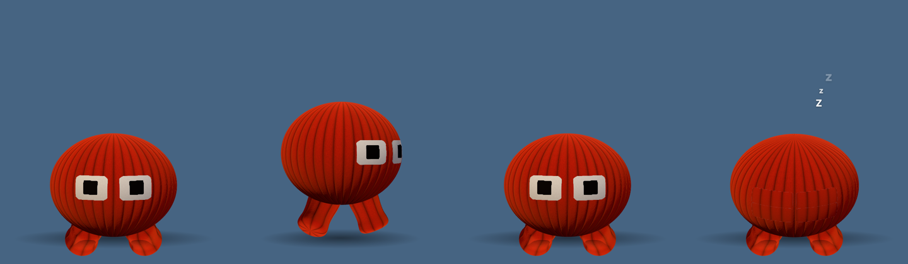
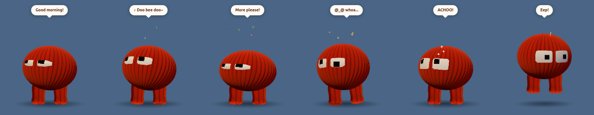
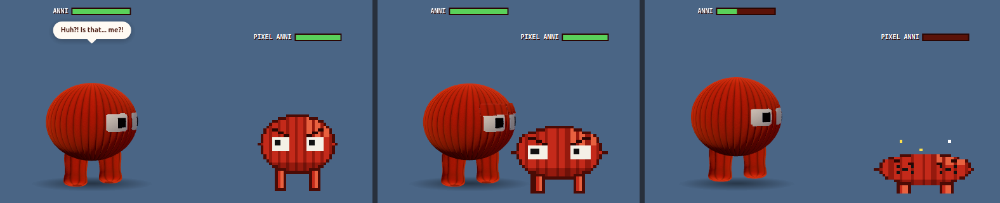

# ANNI — your desktop antimatter buddy

<p align="center"></p>

**ANNI** (**AN**tiproton-**AN**t**I**matter) is a small red corduroy plush who lives at the bottom of your
screen. He walks around, follows your mouse, talks, sings, does backflips, falls asleep when you're away,
and now and then fights his own 8-bit evil twin.

He's built entirely in code: three.js inside a transparent Electron window. There are no 3D model or
sprite files.

## Where Anni comes from

Anni first appeared in **[AEgIS: Antihydrogen Gravity Lab](https://github.com/Bharat-Singh-Rawat/AEgIS_Gravity_game)**,
a browser game for outreach about the [AEgIS experiment](https://home.cern/science/experiments/aegis) at CERN.
In the game you work in the AEgIS lab at CERN's Antiproton Decelerator. You trap antiprotons, make
positronium, laser-cool it, build antihydrogen, and then measure how antimatter falls under gravity.

Anni's name comes from **antiproton–antimatter**. You'll find him, and collect him, in the
**first stage** of the game: *Antiproton Capture*. This repo lets him leave the lab and keep you company
on your desktop.

## Install

Anni runs on **Windows, macOS and Linux**. You need **[Node.js](https://nodejs.org)** (the LTS
version), installed once.

```bash
git clone https://github.com/Bharat-Singh-Rawat/anni-desktop.git
cd anni-desktop
npm install        # downloads Electron, takes about a minute the first time
npm start
```

Or skip the terminal and double-click a launcher. It installs on the first run and starts Anni:

| OS | Launcher |
|---|---|
| Windows | `Start Anni.bat` |
| macOS | `Start Anni.command` (first time: right-click → **Open**) |
| Linux | `./start-anni.sh` |

### Linux: the Chromium sandbox

On many distros (for example Ubuntu 24.04 and newer), Electron stops at startup with
*"The SUID sandbox helper binary was found, but is not configured correctly"*. `./start-anni.sh` detects
this and starts Anni with `--no-sandbox`. Anni only loads his own local files, so that's low risk.
To fix it properly, run this once:

```bash
sudo chown root:root node_modules/electron/dist/chrome-sandbox
sudo chmod 4755 node_modules/electron/dist/chrome-sandbox
```

If you launch with `npm start` and haven't done that, use `npx electron . --no-sandbox` instead.

### Build an installer (optional)

```bash
npm run dist
```

This puts a normal installer (`.exe` / `.dmg` / `AppImage`) in `dist/`. Build on the OS you're targeting.

## Turning him on and off

- **Tray / menu-bar icon** (a little Anni face): click it to put him away or wake him up. Right-click it
  for the full menu.
- **Keyboard:** `Ctrl+Alt+A` (macOS: `Cmd+Alt+A`) toggles him from anywhere.
- **Start Anni when I log in** in the menu wakes him with your computer.
- **Quit Anni** closes him completely.

## Playing with him

<p align="center"></p>

| You do | Anni does |
|---|---|
| Move your mouse | His eyes and head follow it, anywhere on screen |
| Click him | Hops, squeaks, says something |
| Double-click | Spins |
| Wiggle the mouse over him | Gets petted: squinty happy eyes, hearts and a purr |
| Hold the mouse still just above his head | Jumps to try to catch it |
| Whoosh the mouse past him fast | Gets startled and hops away |
| Drag him | Picks himself up with legs dangling and complains if you hold him too long |
| Fling him and let go | Flies, bounces off the screen edges and lands |
| Shake him side to side while dragging | Gets dizzy when you put him down |
| Poke him lots of times quickly | Gets grumpy and turns his back on you for a bit |
| Move the mouse far away | Sometimes walks over to visit, or always with **Follow my mouse** |
| Leave him alone | Wanders, sings, dances, does backflips, yawns, sneezes, looks around and chats |
| Don't touch the mouse for 2 minutes | Falls asleep (Zzz) and talks in his sleep. Move the mouse to wake him |
| Right-click him | The menu: say hi, hop, spin, dance, sing, backflip, sit, nap, come to my mouse... |

He also greets you by time of day, nudges you to drink water or stretch, and suggests a break after
about 50 minutes at the computer.

### Pixel twin fight

<p align="center"></p>

Pick **Pixel twin fight!** from the menu. An 8-bit evil twin assembles itself pixel by pixel next to
Anni and claims to be *the real Anni*. Then they fight: HP bars, wind-ups and lunges, knockback, dodges,
critical hits, Anni's spin attack and the twin's glitchy *PIXEL PUNCH*, all with chiptune sound effects.

- **Click the twin** to bonk it and help Anni (it will complain: *"HEY! 2 V 1?!"*).
- When the twin loses it's flattened, says *GAME OVER* and dissolves into pixels. When Anni loses, he
  demands a rematch.
- Pick the menu item again to call a truce.

### Menu settings

- **Wander around**: walk along the bottom of the screen on his own.
- **Follow my mouse**: walk after the cursor.
- **Squeaks and sounds**: on or off.
- **Size**: small, medium or large.

## How it works

| File | What it does |
|---|---|
| `main.js` | Electron main process: the transparent always-on-top window, tray, menus, hotkey, settings, and the pixel twin's window |
| `preload.js` | The small, isolated bridge between the windows and the main process |
| `renderer/model.js` | Builds Anni's body: procedural corduroy texture and normal map, felt eyes, eyelids, legs |
| `renderer/anni.js` | Anni's brain: behaviour, mouse reactions, speech, sounds (Web Audio), animation, and the fight director |
| `renderer/twin.js` | The pixel twin: a procedurally drawn 8-bit sprite. It's a puppet that Anni's window directs |
| `renderer/vendor/three.module.js` | three.js |

Want to change him?

- Colours, eye size and leg length are in `renderer/model.js`.
- Walk speed, how often he does things, when he sleeps and **what he says** (look for `HI`, `CHATTER`
  and `SLEEP_TALK`) are in `renderer/anni.js`.
- The twin's trash talk is in the `TWIN_*` lists, also in `renderer/anni.js`.

## Credits

- Anni comes from [AEgIS: Antihydrogen Gravity Lab](https://github.com/Bharat-Singh-Rawat/AEgIS_Gravity_game).
- Built with [Electron](https://www.electronjs.org/) and [three.js](https://threejs.org/).

## License

[MIT](LICENSE)
